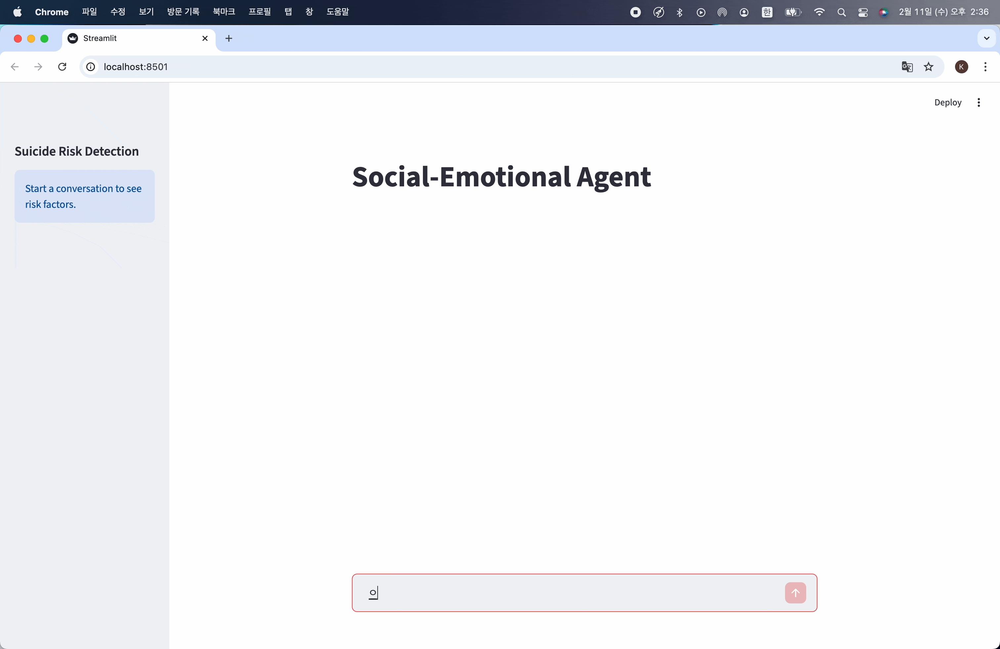
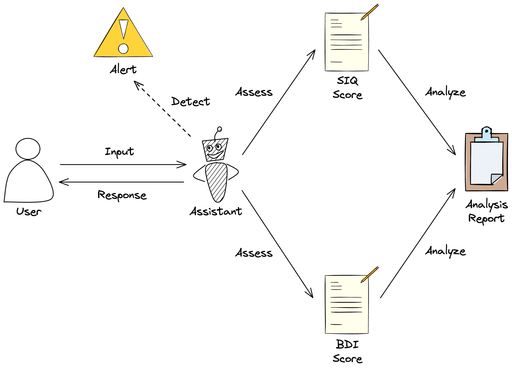
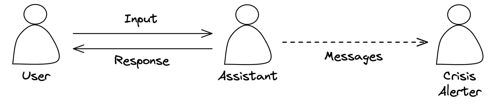
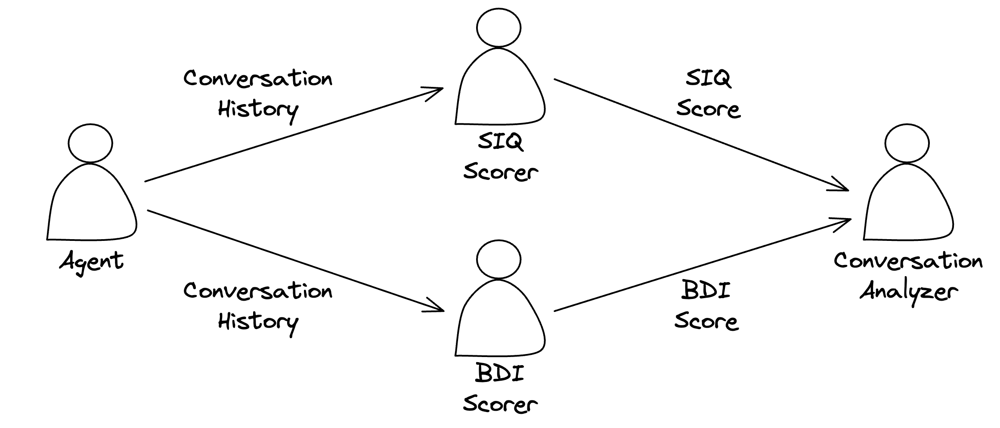

# Social-Emotional Agent



## Overview

This project implements an agentic system for **adolescent social-emotional support and suicide prevention** using LangGraph.



## Setup

### Prerequisites

- Python 3.13
- uv
- OpenAI API Key

### Installation

```
uv sync
```

### Environment Variables

Copy the `.env.example` file to `.env` and fill in your API keys.

```
cp .env.example .env
```

## Usage

### Launch demo

```
uv run --env-file .env streamlit run app.py
```

## Agent



- Structured output: extracts suicide risk factors
- Conditional routing: routes to crisis alerter based on extracted risk factors
- Determines conversation continuation for every response

## Workflow



- Parallel assessment: assesses SIQ-JR and BDI-II simultaneously
- LLM-as-a-Scorer: scores SIQ-JR and BDI-II items based on conversation history
- Generates analysis report from conversation history and assessment scores

## Files

- `graph.py`: Graph definition
- `nodes.py`: Node definitions
- `prompts.py`: Prompt templates
- `schemas.py`: Structured output schemas
- `state.py`: State definition
- `app.py`: Streamlit demo
